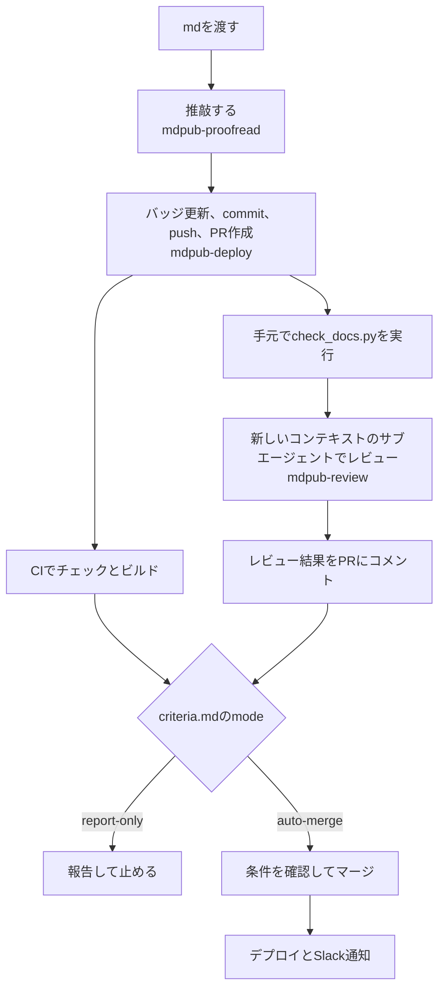

## はじめに

mdpubは、学習メモを共有するための個人Wikiだ。
Astro StarlightとCloudflare Workersで動き、メモごとにGiscusでコメントができる。
使い方は単純で、`src/content/docs/` にmdを置いてpushするだけ。

ZennやはてなブログのようなパブリックなWebサイトではなく、近い人に向けて垂れ流したり、自分の頭の中を整理したりするのに使える、気軽な公開ツールが欲しかった。
それで作ったのがmdpubだ。

この記事では、公開フローを支える4つのSkillを、導入した順に振り返ってみる。

## 作ったSkill

Skillは `.claude/skills/` 配下に置いている。

| Skill | 役割 | 追加日 |
| --- | --- | --- |
| `mdpub-deploy` | バッジを更新し、commit、push、PR作成まで進める | 2026-06-17 |
| `japanese-tech-writing` | 日本語技術文書の文章規範（公開されているスキルを導入） | 2026-06-30 |
| `mdpub-proofread` | 文章規範を読み込み、mdpub固有の規範を上乗せして推敲する | 2026-06-30 |
| `mdpub-review` | 機械チェックとレビュー用サブエージェントで確認し、基準に沿ってマージまたは報告する | 2026-10-25 |

全体の流れはこうなっている。

## 最初はバッジ付けから

最初に作ったのは `mdpub-deploy` だった。

きっかけは、モデルの思考を読んでいくと、毎回Pythonスクリプトを書いていると気がついたことだった。
そのスクリプトを切り出して用意しておけば、トークンの節約になり、確実性も上がると思った。
Starlightでは、frontmatterの `sidebar.badge` でサイドバーにバッジを出せる。
mdpubでは、追加したページに「新規」、変更したページに「更新」を付けている。

バッジの判定は `update_badges.py` に任せた。
スクリプトは `src/content/docs/` 配下のMarkdownを走査し、git diffの結果に応じてバッジを付け替える。

- **新規**：git diffで追加（A）になったファイル
- **更新**：git diffで変更（M）になったファイル
- **info**：手動で付けた保護対象で、スクリプトは触らない
- **なし**：変更のないファイルで、badgeフィールドを削除する

Skillには「バッジ付け替えはスクリプトが行う。モデルはオーケストレーションに徹する。」と書いた。
注意事項にも、モデルがdiffを解釈してbadgeを書き換えてはいけないと明記した。
スクリプトは冪等なので、何度実行しても同じ結果になる。

## 校正は公開されているスキルを入れた

次に入れたのが、文章規範の `japanese-tech-writing` と、それを使う `mdpub-proofread` だった。

`japanese-tech-writing` は自分で書いたものではない。
ライターさんが公開しているスキルを導入した。
AIが書いた文章をそのまま載せるより、規範を通した方が読みやすくなると思ったからだ。

導入したのは、k16shikanoさんがGistで公開している[japanese-tech-writing](https://gist.github.com/k16shikano/fd287c3133457c4fd8f5601d34aa817d)だ。
mdpubには2026年6月16日時点の版を、手を加えずに置いている。

`mdpub-proofread` は、作業前にこの規範を読み込み、そのうえにmdpub固有の規範を上乗せする構成にした。

規範の整形の節には、たとえばこんなことが書かれている。

- 一文ごとに改行し、段落の区切りは空行で示す
- 日本語の地の文と見出しでダッシュを使わない
- 日本語の並列に中黒を使わない
- 用語と定義の箇条書きは「**用語**：説明」と書く

論証の節には、推量や可能性として書かれた文を機械的に断定へ変えないことが書かれている。
さらに、LLMが大量生成する中身のない型を禁止する節がある。
挙がっているのは、こういう言い回しだ。

- **予告と総括**：「重要なのは〜である」「ここでは〜について見ていく」など
- **正面から系**：「正面から扱う」「正面から回収する」など
- **空虚な形容**：「不可欠」「多角的」「包括的」など
- **空虚な動詞**：「言語化する」「言及する」など、何をどう書いたかを示さずに終わるもの
- **接続の型**：新しい情報のない「〜において」「〜の観点から」など

`mdpub-proofread` では、mdpubの記事の型に合わせた規範を足した。
Q&Aは「問い、結論、根拠」の順を保ち、TL;DRには結論だけを置く。
frontmatterの `title`、`description`、`sidebar.badge` は変えない。
また、規範は空虚な動詞としての「深掘りする」を禁止しているが、mdpubではページの種別ラベルとして「深掘り」を使っている。
そのため、`mdpub-proofread` では、タイトルや見出しのラベルとしての「深掘り」は残してよいと書き分けた。

## レビューを別のエージェントに分けた

最後に作ったのが `mdpub-review` だった。
推敲した書き手とは別のコンテキストでレビューし、基準を満たすPRだけをマージする仕組みにした。
分ける理由は、[サブエージェントを減らす話と、レビューを分ける理由](/fold-subagents-into-main-loop/)にまとめたので、ここでは仕組みだけを書く。

チェックは3つの層に分けた。

- **機械チェック**：`check_docs.py` とCIが、frontmatter、バッジの値、ダッシュ、崩れる太字、ビルドを見る
- **意味のレビュー**：レビュー用サブエージェントが、論旨の改変、推量の断定化、原稿にない内容の追加などを見る
- **基準**：人間が `criteria.md` で、何をブロッカーとするかと運用モードを決める

レビュー用サブエージェントには、forkではなく新しいコンテキストを使うことにした。
渡すのは、基準ファイルと文章規範の場所、元原稿、成果物だけだ。
PRの説明文やコミットメッセージは読ませない。
`criteria.md` は人間が決める基準の原本で、エージェントは自分の判断で書き換えない。

## 作ってよかったこと

前より、公開までの作業が早くなった気がする。
一からPythonスクリプトを書かせるのではなく、スクリプトでルールを絞れているので、モデルのやることが明確になっているのだと思う。
結構手放しで公開まで行けるようになった。

## 次にやりたいこと

`criteria.md` の運用モードは、今は `report-only` にしている。
このモードでは、レビュー結果をPRにコメントして報告し、マージは人間がする。

リポジトリの運用メモでは、人間の判断とレビュアーの判断が数回続けて一致したら `auto-merge` に切り替えることにしている。
実際には、自動レビューの質を上げていき、納得のいく文章が多く出てくるようになったら切り替えたい。
`auto-merge` では、次の条件をすべて満たしたときに限りClaudeがマージする。

- 変更が `src/content/docs/` 配下だけである
- CIが通っている
- レビューのブロッカーが0件である

スキル、ワークフロー、設定を変えるPRは、モードによらず人間がマージする。
