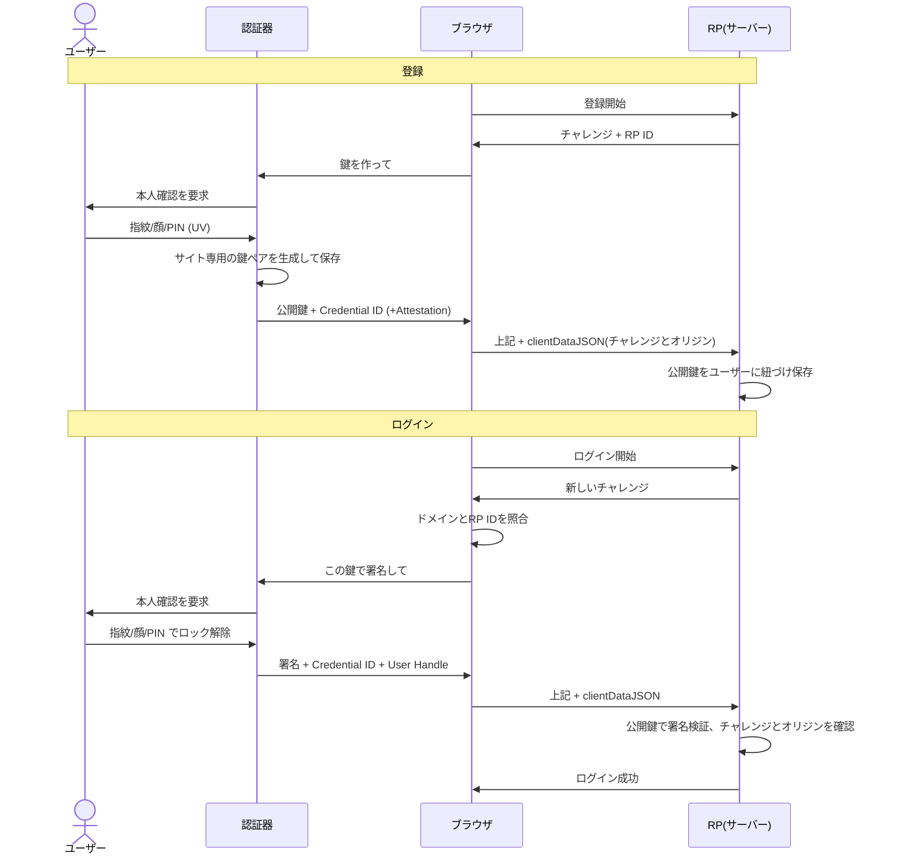

## 出発点

- 当初の理解：「生体認証で、秘密鍵と公開鍵を使って認証する」くらい
- 知りたかったこと：その裏にある概念と用語

## 全体の地図

| 区分 | 用語 | ひとことで |
|---|---|---|
| 登場人物 | ユーザー / 認証器（Authenticator）/ ブラウザ / RP（Relying Party） | 認証器＝スマホやYubiKey、RP＝ログイン先サービス |
| 規格 | FIDO2 ＝ WebAuthn ＋ CTAP | WebAuthn：RPのWebページがブラウザ経由で認証器を使うためのAPI、CTAP：ブラウザ（OS）⇔認証器の通信 |
| 核の仕組み | チャレンジ・レスポンス、オリジン束縛 | リプレイ防止とフィッシング耐性の正体 |
| パスキー特有 | 同期型/デバイス固定型、Discoverable Credential、UV/UP、Attestation | 以下で順に説明 |

## 登録からログインまでの流れ

## 1. 生体認証は「金庫の鍵」であって、送られるものではない

**最初の理解**：端末で認証して、OKの合図か署名を送る？

**整理**：
- 生体情報は端末内で照合されるだけで、サーバーには送られない
- 生体認証の役割は **秘密鍵のロック解除**
- サーバーに届くのは「OKの合図」ではなく **秘密鍵で作った署名**
  - 合図はただのデータなので偽造できる。署名は秘密鍵がないと作れない
- 本人確認の度合いは、署名対象のデータ（authenticatorData）に含まれるフラグで送られる
  - **UV（User Verification）**：生体認証やPINで本人確認した
  - **UP（User Presence）**：誰かが触れた（本人かは問わない）

## 2. チャレンジ：署名を使い捨てにする

**最初の疑問**：固定文字列でも、秘密鍵が漏れなければなりすませないのでは？

**整理**：
- 漏れて困るのは文字列ではなく **署名そのもの**
- 固定文字列だと署名も毎回同じ → 盗み見た署名をそのまま送ればログインできる（**リプレイ攻撃**）
- 毎回ランダムなチャレンジに署名させると、署名がその回限りの使い捨てになる
- 暗号プロトコルのnonce（一度だけ使う値）と同じ発想

## 3. オリジン束縛：フィッシング耐性の正体

**問い**：偽サイトが本物のチャレンジを中継し、返ってきた署名を本物に転送したら？

**最初の発想**：パスキーとサービスをセットで記憶し、記憶にない所は拒否すればいい → **正解の方向**

**整理（二重の防御）**：
1. **鍵はRP ID（ドメイン）に紐づいて保存**される。ブラウザが今のドメインと照合し、一致する鍵しか使わせない。偽ドメインでは本物の鍵が候補にすら出ない
2. **署名対象にオリジンが含まれる**（clientDataJSONのハッシュが署名対象に入る）。中継されても「evil.comで作られた」と刻まれているので、本物サーバーが検証で弾く

**ポイント**：ドメイン確認をするのは人間ではなくブラウザ。SMSのワンタイムコードはユーザーが偽サイトに入力すれば中継されるが、パスキーは人の注意力に依存しない。

## 4. 同期型パスキー：秘密鍵は本当に端末から出ないのか

**最初の疑問**：機種変更で秘密鍵を持っていけないはず。ハッシュ化してサーバーに保存？

**整理**：
- **ハッシュではなく暗号化**。ハッシュは元に戻せないので、新端末で署名に使えない
- iCloudキーチェーンやGoogleパスワードマネージャーが **エンドツーエンド暗号化** して同期。復号鍵はユーザー端末側（画面ロックのパスコード等と結びつく）にあり、事業者は読めない
- 「秘密鍵は端末から出ない」は厳密には **デバイス固定型** の話

| | 同期型（Synced） | デバイス固定型（Device-bound） |
|---|---|---|
| 例 | iCloud / Google | YubiKey |
| 機種変・紛失 | 復元できる | 復元不可（予備キー推奨） |
| 鍵の所在 | 暗号化して複数端末へ | その1台のみ |

### 同期型で生まれた新しい狙いどころ

**自分の発想**：端末の復号鍵やパスコードを盗まれたら？ → **現実に起きている攻撃**

- **端末パスコード**：生体認証はパスコードの便利な代替入口にすぎない。総当たりは専用チップ（Secure Enclave等）が試行回数を制限するので、現実的なのは **盗み見してから端末を盗む** 手口
- **同期アカウント（Apple ID / Googleアカウント）**：全パスキーの親玉。乗っ取られると鍵を同期される恐れがあるため、復元時に元端末のパスコード等も要求して二重に守る

**構造**：各サイトのパスワード管理リスクを「1アカウント＋端末パスコード」に集約した。攻撃面は狭いが、破られた時の被害は大きい。パスワードマネージャーと同じ構造。

## 5. 登録時：鍵ペアはどこで作られるか

**自分の回答**：端末で鍵ペアを作り、公開鍵だけ送る。SSHと同じ定石。接続ごとに鍵を分けるはず → **正解**

**整理**：
- 端末が送るのは **公開鍵** と、その鍵を識別する **Credential ID**
- 鍵ペアは **登録のたびに新規生成** される。したがってサイト（RP ID）ごとに必ず別の鍵になる
- 理由はセキュリティに加えて **プライバシー（unlinkability／非連結性）**
  - SSHで1つの公開鍵を使い回すと、サーバー間で同一人物と突き合わせられる（GitHubは `github.com/ユーザー名.keys` で公開鍵が見える）
  - パスキーはサイトごとに鍵が違うので、サイト同士が結託しても名寄せできない

### SSHとの対比

| 観点 | SSH | パスキー |
|---|---|---|
| 鍵ペア生成 | クライアント側 | 認証器側 |
| 鍵の使い回し | 運用次第（使い回しがち） | サイトごとに強制的に別 |
| 偽サーバー対策 | `known_hosts` の警告を **人間が判断** | オリジン束縛で **ブラウザが自動強制** |

## 6. Discoverable Credential：ユーザー名なしでログインできる理由

**自分の回答**：登録したCredential IDで一意に識別している → **正解**

**整理**：分かれ目は「**認証器側も覚えているか**」

- **Discoverable（ユーザー名不要）**
  - 認証器が RP ID・Credential ID・**User Handle**（ユーザー識別子）を内部に保存
  - ブラウザが「example.com用の鍵ある？」と聞くだけで候補が出る
  - 署名と一緒に Credential ID と User Handle が返り、サーバーはそれで誰かを引き当てる
- **Non-discoverable（ユーザー名が先に必要）**
  - 認証器は何も保存しない。Credential IDの中に秘密鍵を暗号化して埋め込む方式がある
  - サーバーがユーザー名からCredential IDを引き、認証器に渡して署名させる
  - 認証器の保存領域を消費しない。セキュリティキーは保存枠が限られる（例：YubiKey 5はファームウェア5.7未満で25件）ため、パスキー普及以前はこちらが主流だった
- **「パスキー」という呼び名は基本的にDiscoverableを指す**

## 7. Attestation：その鍵は本物のハードウェア製か

**自分の発想**：「署名の署名」のように包み込む仕組みがあれば？ → **まさにそれ**

**整理**：
- 認証器には工場出荷時に **Attestation用の秘密鍵** が埋め込まれている
- 登録時、新しい公開鍵をAttestation鍵で **さらに署名** して送る
- サーバーはメーカーのルート証明書まで辿って検証（TLSの証明書チェーンと同じ構造）
- 機種は **AAGUID** で識別、FIDO Allianceの **MDS（Metadata Service）** で安全レベルを確認できる
- **プライバシー配慮**：Attestation鍵が端末ごとに違うと追跡IDになるため、同機種の大量の端末（FIDOの要件では10万台以上）で同じ鍵を共有する（非連結性と同じ思想）
- **実際の使われ方**：一般向けサイトの多くは要求しない。同期型は鍵が端末間を移動するので保証の意味が薄く、Apple等は基本提供しない（Attestationは「none」で返る）。厳密に使うのはYubiKeyを配布する企業・行政など、デバイス固定型と組み合わせる場面

## 横断的な気づき

- **使い捨てにする発想**（チャレンジ）は nonce と同型
- **人間の判断を仕組みで置き換える**（オリジン束縛）は SSHの `known_hosts` 警告の進化形
- **非連結性**は「サイトごとの鍵」と「Attestation鍵の共有」の両方に通底する設計思想
- **リスクの集約**（同期型）はパスワードマネージャーと同じトレードオフ：攻撃面は狭く、被害は大きく
- **「秘密鍵は端末から出ない」は同期型では不正確**。標語は前提条件ごと覚える

## 用語集

| 用語 | 意味 |
|---|---|
| RP（Relying Party） | ログイン先のサービス |
| RP ID | 鍵を紐づけるドメイン |
| Authenticator | 鍵を保持し署名する装置（スマホ、YubiKey等） |
| WebAuthn | RPのWebページがブラウザ経由で認証器を使うためのAPI仕様 |
| CTAP | ブラウザ（OS）⇔認証器間の通信プロトコル |
| FIDO2 | WebAuthn ＋ CTAP の総称 |
| チャレンジ | サーバーが毎回発行するランダム値 |
| clientDataJSON | チャレンジやオリジンを含む、署名対象のデータ |
| Credential ID | 鍵ペアを識別するID |
| User Handle | RPが割り当てるユーザー識別子 |
| UV / UP | 本人確認済み / 人が触れた、のフラグ |
| Discoverable Credential | 認証器側に保存され、ユーザー名なしで使える資格情報 |
| Synced / Device-bound | 同期型 / デバイス固定型パスキー |
| Attestation | 認証器の出自をメーカー鍵で証明する仕組み |
| AAGUID | 認証器の機種ID |
| MDS | FIDO Allianceの認証器メタデータ提供サービス |
| unlinkability | 異なるサイト間で同一人物と結びつけられない性質 |
